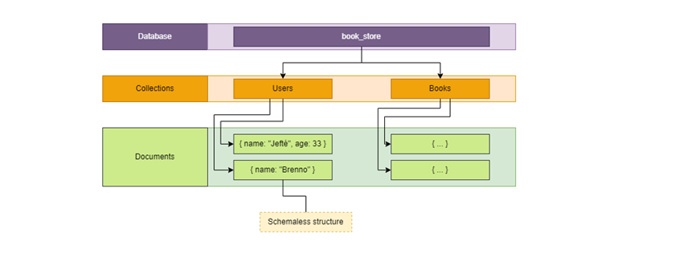
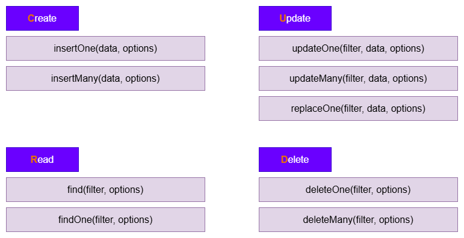

#  Guia de Aprendizado  NoSQL e MongoDB

> Repositório contínuo para registro de conceitos praticos e teoricos   desenvolvidos na disciplina de **Bancos de Dados NoSQL / MongoDB**.

---

## 1. SQL vs NoSQL

### O que é NoSQL?
**NoSQL** (*Not Only SQL*) é um paradigma de banco de dados não-relacional projetado para oferecer:
* **Flexibilidade:** Permite estruturas dinâmicas e sem esquema rígido (*Schemaless*).
* **Escalabilidade:** Facilidade para escalabilidade horizontal em múltiplos servidores.
* **Alto Desempenho:** Otimizado para leitura e gravação de grandes volumes de dados.

---

### Principais Paradigmas NoSQL

1. **Orientados a Documentos (*Document*):** Armazena dados em estruturas hierárquicas semiestruturadas (ex.: JSON/BSON). *(Ex.: MongoDB)*
2. **Chave-Valor (*Key-Value*):** Cada item é salvo como um par de chave e valor de acesso ultrarrápido. *(Ex.: Redis)*
3. **Famílias de Colunas (*Column Store / Wide-Column*):** Armazena e consulta dados organizados por colunas em vez de linhas. *(Ex.: Cassandra)*
4. **Orientados a Grafos (*Graph*):** Focado em estruturas de redes, nós e arestas para representar relações complexas. *(Ex.: Neo4j)*

---

## 2. Introdução ao MongoDB

* **O que significa "Mongo"?** Origina-se de ***Humongous*** (gigante), criado para gerenciar grandes volumes de dados de maneira eficiente.
* **Paradigma:** Banco de dados NoSQL de código aberto, orientado a documentos e sem esquema fixo (*Schemaless*).
* **Estrutura Hierárquica:**
  * `Database`: Contêiner lógico do sistema.
  * `Collection`: Agrupamento de registros (equivalente às tabelas no modelo relacional).
  * `Document`: Registro individual estruturado em **BSON** (*Binary JSON*).

---

## 3. Formato de Dados: JSON / BSON
* **Registro em Documento:** Todo registro salvo no MongoDB é um documento.
* **BSON (*Binary JSON*):** Formato binário serializado utilizado internamente pelo banco para armazenamento e transporte rápido de dados.
* **Estrutura Chave-Valor:** Documentos BSON são compostos por pares ordenados contendo um **nome de campo (*field name*)** e um **valor (*value*)** com seu tipo de dado correspondente.

---

## Um servidor MongoDB pode hospedar múltiplos bancos de dados.
* **Cada banco de dados contém coleções (collections), e cada coleção armazena documentos (documents).**

  

### Modelagem de Dados e Relacionamentos
* **Sem Necessidade de JOINs:** O MongoDB minimiza o uso de relacionamentos externos e junções pesadas entre coleções.
* **Documentos Incorporados (*Embedded Documents*):** Em vez de separar entidades em várias tabelas relacionais, os dados relacionados são armazenados diretamente dentro do mesmo documento (usando subdocumentos ou listas/arrays), otimizando a velocidade de leitura.

---

### Principais Comandos de Terminal 

├── `mongosh` (Inicia o terminal interativo do MongoDB Shell
)
 
├── `show databases` *(ou `show dbs`)*` (ista todos os bancos de dados existentes)
 
├── `use <nome_do_banco>` (Seleciona ou cria um banco de dados de trabalho)
 
├── `show collections` (Exibe todas as coleções do banco atual)
 
├── `db.createCollection("<nome>")` (ria explicitamente uma nova coleção)

├── `db.<collection>.insertOne({ ... })` (Insere um único documento (objeto) na coleção)

├── `db.<collection>.find()` (Consulta e exibe todos os documentos da coleção)

---

## 4. Estrutura de Dados e Operações CRUD

###  Hierarquia: Databases, Collections e Documents
A organização dos dados no MongoDB ocorre em três níveis hierárquicos:

* **Database (Banco de Dados):** O contêiner principal do sistema.
* **Collection (Coleção):** Agrupador de documentos (equivalente às tabelas). Podem ser criadas de forma explícita ou implicitamente ao inserir o primeiro documento.
* **Document (Documento):** Registro individual contendo os dados estruturados.

---

###  Anatomia de um Documento JSON

Um documento JSON no MongoDB possui regras estruturais bem definidas:

* **Estrutura:** Delimitado por `{ ... }` com pares `chave: valor` separados por vírgulas `,`.
* **Tipos de Dados:** Suporta Strings, Numbers, Booleans, Arrays (`[ ... ]`) e Objetos/Documentos Incorporados (`{ ... }`).
---

### 5. Métodos das Operações CRUD

O MongoDB implementa o CRUD através de métodos específicos para cada ação:

  

##  Estrutura do Repositório

* 📄 [README.md](./README.md) — *Resumo dos conceitos teóricos da disciplina*
* 📁 [assets/](./assets/) — *Imagens e diagramas*
  * ├── 🖼️ [crud.png](./assets/crud.png) — *Diagrama de operações CRUD*
  * ├── 🖼️ [collections.png](./assets/collections.png) — *Collections e Armazenamento*
* 📝 [exemplos.mongodb](./exemplos.mongodb) — *Exemplos práticos trabalhados nas aulas*
